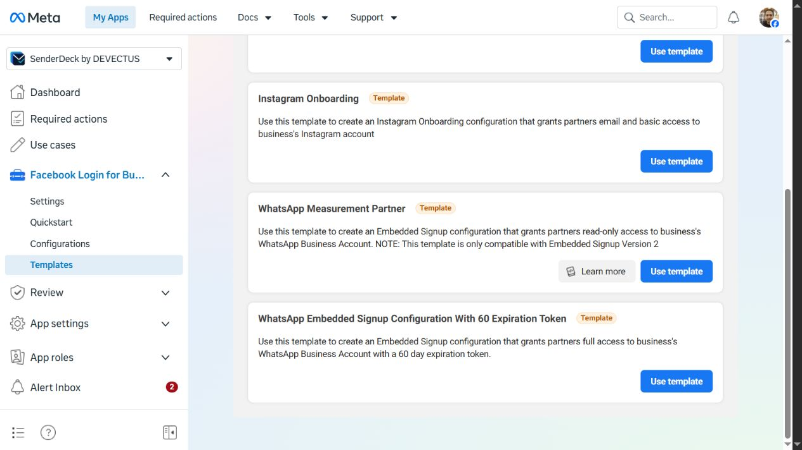

# WhatsApp App Review preparation — 26 October 2026

**Later update:** the owner subsequently approved the separate configuration, SDK domain/login and four additional webhook fields. These are now completed; see [the configuration receipt](WHATSAPP-META-CONFIGURED-2026-10-26.md). The findings below describe the earlier preparation pass, not current configuration status.

Status: local preparation only. No submission, owner declaration, new credential, OAuth grant, subscription change, phone connection, outbound message or production deployment was performed in this preparation pass.

## Verified app state and corrected diagnosis

App: SenderDeck by DEVECTUS, `2213673322866707`. Portfolio: `9800299636712367`. Target Business app number: `+61 485 040 099`; preserve its phone registration.

| Check | Evidence observed in the authenticated Meta dashboard |
| --- | --- |
| WhatsApp product/use case | “Connect with customers through WhatsApp” is already present; adding the use case is not the missing step. |
| Business verification | Verified. |
| Access verification | Tech Provider, In review. This is distinct from Business verification and WhatsApp permission review. |
| Custom configuration wizard | Previous inspection offered only General. Do not substitute this for Embedded Signup. |
| Template route | Facebook Login for Business > Templates **does contain** “WhatsApp Embedded Signup Configuration With 60 Expiration Token”. The earlier conclusion that Embedded Signup is wholly unavailable was too broad. |
| SDK settings | Login with the JavaScript SDK = No; Allowed Domains for the JavaScript SDK is empty. Client OAuth, Web OAuth, HTTPS and Strict Mode are enabled. Embedded browser OAuth login is disabled. |
| Permission requests | Both WhatsApp permissions remain Not submitted; each form shows **0 of 1 API calls required**, an empty description and no uploaded recording. Counters can lag by 24 hours. |
| Submission | Existing draft `2213804016186971` contains unrelated Facebook/Instagram/ads requests too. No requests were removed or changed. Submit is disabled until all required sections are complete. |
| App publication | Unpublished. |

**Conclusion:** missing custom-wizard variation is not evidence that pending App Review hides every Embedded Signup route. A documented template is available in this app. Its successful creation/use is unverified because we stopped before creating persistent configuration/access. Pending Tech Provider access is a real onboarding dependency, while disabled SDK login and missing domain allowlisting are separate configuration blockers. Meta's WhatsApp App Review guide allows development testing at Standard access with app roles; external-business access requires Advanced access. It explicitly says App Review can begin before Embedded Signup is fully implemented. Waiting for Tech Provider review alone will not finish these developer-side steps. The internal reason the custom wizard omits the variation is not disclosed by the dashboard.

The Quickstart/use-case panel remained on a loading spinner during inspection. Do not interpret that rendering problem as an eligibility denial. If the template route fails after approval, capture its exact error and ask Meta support to reconcile the app's use-case entitlement with the available template. Do not create a replacement app or alter the existing general configuration as a workaround.

## Permission descriptions, ready for owner review

These describe implemented behavior and intended permission use. They do not attest that live onboarding or delivery has passed. Paste only after owner review; leave allowed-use agreement unchecked until the authorised owner accepts it.

### whatsapp_business_management

> SenderDeck lets authorised businesses connect their WhatsApp business assets to a selected customer workspace and brand. We use whatsapp_business_management to discover the phone numbers in a business-authorised WhatsApp Business/Messaging account, verify that the exact selected phone belongs to that account, and subscribe and verify our app's webhook delivery for that account. These checks prevent connecting another customer's number or reading events for an unselected account. For WhatsApp Business app Coexistence, the business completes Meta Embedded Signup and retains use of its phone app; SenderDeck verifies simultaneous Business app and Cloud API state. Tokens are exchanged server-side and encrypted at rest. We need this permission for asset discovery, account verification and webhook management supporting the conversation workflow. SenderDeck does not currently create or edit templates, register/deregister phone numbers, or migrate the phone registration.

### whatsapp_business_messaging

> SenderDeck helps authorised business staff review customer-initiated WhatsApp conversations and prepare text replies. Signed incoming webhooks are routed by the exact business account and phone number, encrypted and retained under the selected brand's retention policy. A staff member reads the available context, creates a local draft, inspects its exact recipient, wording and revision, then explicitly approves that revision before sending. The server rechecks permissions, account ownership, unchanged context and the 24-hour response window immediately before an API reply. Coexistence adds permitted initial history synchronization and phone-app outgoing echoes; imported history and outgoing echoes never open the API response window. Media and unsupported events require native review. This permission is necessary to receive and send these business messages. Templates, media sending, business-initiated messages outside the response window and unattended sending are unavailable.

## Required recordings and live API evidence

Produce **one separate video per permission**. A screenshot, mock demonstration or local automated test does not meet Meta's recording/API-call requirements. Do not film tokens, passwords, unrelated conversations or third-party address books. Do not claim completed steps that remain gated.

| Permission | Recording script | Missing live evidence / approval |
| --- | --- | --- |
| management | Show app ID, selected test brand, authorised account/number discovery, exact number selection, live validation and account subscription readback. Explain the asset and webhook use accurately. | Meta's guide specifically asks for template creation in the app **or WhatsApp Manager**. SenderDeck has no template editor. Arrange an owner-authorised, disposable test WABA and demonstrate template creation in WhatsApp Manager as a separate provider step, alongside the actual SenderDeck management use. This is not yet recorded and must not be presented as a SenderDeck feature. Confirm any template side effect before doing it. A successful read-only management call such as `GET /{TEST_WABA_ID}/phone_numbers` can be tested only with an existing, appropriately authorised app grant; no grant was generated here. Confirm the dashboard counter afterwards. |
| messaging | Use a consenting test recipient to send a fresh inbound text. Show its arrival in SenderDeck, the history-limit acknowledgement, local draft, exact inspection, separate human approval and one text reply. Show the same reply received in the recipient's WhatsApp client. | Requires an authorised test sender/recipient and a separately approved exact message. No live send was made. Sandbox Embedded Signup accounts cannot send/receive messages and cannot satisfy this demonstration. Confirm native receipt and the API test counter afterwards. |

Suggested test wording to review later: “SenderDeck connection test. Please confirm receipt.” It is only a proposed draft; no recipient or send is authorised by this document. Sending policy gates remain unchanged.

For Coexistence acceptance separately record: the Coexistence-specific finish event, exact-number match, `is_on_biz_app=true` and `platform_type=CLOUD_API`, signed sync events and native outgoing echo, declined-history behavior, and continued normal phone-app use. Do not use the real target number for a destructive registration or migration test. A passing generic Cloud API demonstration is not proof of Coexistence.

## Reviewer access instructions draft

Entry point: `https://senderdeck.devectus.com.au/connect/meta?provider=whatsapp`. Select the dedicated test brand and connection type. The production Coexistence option is intentionally gated until the separate configuration is supplied. An owner must supply a working reviewer account and a dedicated test workspace through Meta's secure reviewer fields, then verify sign-in, membership and test-account visibility before submission. Do not reuse a business owner's Google/Microsoft/Meta password, infer an existing marketplace-review credential, create a new credential, or expose real customer workspaces to a reviewer.

Once test access is ready: connect the approved test assets; open Conversations; choose the WhatsApp account and test thread; read context and coverage warnings; create a local draft; inspect the exact revision. Actual send demonstration requires a separate human instruction after inspection. Document exact working steps and any additional permission-specific reproduction instructions in Meta. The current draft is not ready to submit.

The live Reviewer instructions section currently contains Facebook/Instagram instructions and needs a WhatsApp-specific update. It marks Facebook Login integrated = Yes; the test credentials field is blank. Meta asks that any supplied access codes remain active for one year after submission. The owner must approve a suitable dedicated reviewer identity and lifespan rather than copying production credentials. Supporting files are optional; each may be up to 2 GB in the displayed form. No reviewer form fields were changed in this pass.

## Owner data-handling review

The live form pre-fills processor access = Yes, legal controller = DEVECTUS PTY LTD and country = Australia. These are pre-existing answers, **not freshly verified facts**. The processor list, public-authority response question and related policy checkboxes still need owner review. Do not select “No” or certify policies from code inspection.

**Owner confirmation, 27 October 2026:** the owner confirmed in chat that **DEVECTUS PTY LTD, Australia** is the correct legal entity responsible for SenderDeck's Meta data. This confirms the entity/country only. It does not confirm processor contracts, disclosure history, policies, allowed-use agreements or authorise final submission. No Meta declaration was submitted by this update.

**Owner disclosure-history answer, 27 October 2026:** in response to Meta's question about the preceding 12 months and national-security requests, the owner answered: “No, we haven’t provided any Meta personal data to public authorities.” Record **No** for that question. This answer does not establish which policies/processes exist for handling requests. No Meta form submission or policy attestation was performed by this update.

**Process implementation, 27 October 2026:** the owner answered **Unsure** about existing processes, requested help establishing them and nominated themselves as primary privacy officer. A [proposed procedure](../docs/governance/PUBLIC-AUTHORITY-REQUESTS.md), restricted-case/register templates and [adoption/exercise checklist](../docs/governance/ADOPTION-AND-EXERCISE.md) have been prepared. Backup, solicitor/referral path, restricted storage/access checks, formal adoption and owner exercise remain unconfirmed. Leave the four process checkboxes pending until actual implementation is verified. No public legal statement or Meta declaration was changed.

**Storage update, 27 October 2026:** on explicit owner instruction, the business Google Drive folder “DEVECTUS - Restricted Authority Requests” was created with templates, request-case and legal-advice subfolders. The connected business identity was verified as barsham.sotoudeh@devectus.com.au. Metadata for the parent, all three subfolders and all five uploaded files (draft procedure, adoption checklist, blank case/register templates and start guide) listed only that account's owner permission, shared=false, no public/domain/group/other-user grant. The updated drafts were read back successfully. No real case data was uploaded; no sharing invitations sent. This verifies file permission configuration, not MFA, access-history settings, backup behavior or a separate unauthorised-account test. Backup/legal arrangements, adoption and owner exercise remain pending; the four Meta process boxes remain unanswered.

Technical facts available for that review:

- OpenAI Sites hosting, Cloudflare Workers/D1, Meta APIs, and any assistant/client to which the owner exposes conversation content must be evaluated against the owner's actual contracts and data flow. Verify legal processor names, jurisdictions and onward providers before entering them.
- Social tokens, grants, snapshots, drafts and retained message content are encrypted server-side. Processed queue bodies are cleared; initial contacts sync retains receipt/count, not contact names or a phone address book.
- Snapshots expire after 15 minutes; drafts after 24 hours; queued webhook content after 24 hours. WhatsApp message retention follows the brand's 1–90-day policy. Reads enforce expiry; physical cleanup depends on hosted maintenance.
- Disconnect/deletion removes local account content via cascades. Meta signed deletion/deauthorisation callbacks remove affected local records. Provider-hosted conversations remain in Meta/WhatsApp.
- Backup retention, data residency guarantees, actual public-authority disclosures, incident-response practice and contracts cannot be certified from this repository. The owner must supply these answers.
- Existing URLs: `/privacy`, `/terms`, `/api/social/meta/delete`, `/api/social/meta/deauthorize`. Review whether the public privacy text needs an explicit WhatsApp/Coexistence addendum before submission; this pass did not change or publish legal statements.

**Shared-drive transfer, 27 October 2026:** the owner subsequently requested `G:\Shared drives\DEVECTUS Leadership\Business\Policies` and explicitly approved ownership transfer and access for both their business account and Barsham@gmail.com. All nine items moved to that cloud location without changing their IDs. Parent/drive metadata verified Policies and DEVECTUS Leadership; folder sharing verified exactly those two Managers and General access Restricted. This supersedes the earlier My Drive ownership/access state. The procedure, adoption checklist and start guide were updated in place. No real cases or legal advice exist in the empty operational folders; adoption and Meta declarations remain pending.

**Live status recheck, 27 October 2026:** authenticated Verification page shows business verification **Verified** and Tech Provider access verification **In review**. The existing App Review submission still shows **Submit for App Review**, incomplete steps and a disabled Submit for review button; sidebar status **Unpublished**. No submission or declaration changed. Owner confirmed they have an Australian solicitor; firm identity, urgent referral availability and draft review remain pending.

## Exact next actions and approval boundaries

1. **Separate configuration:** approve creating “SenderDeck WA Coexistence” in app `2213673322866707` from the WhatsApp Embedded Signup 60-day template, restricted to WhatsApp Cloud API and the two WhatsApp permissions. Inspect the template's actual defaults before saving; stop if additional scopes/products or terms are compulsory. This approval does not authorise an OAuth grant or phone connection.
2. **SDK settings:** approve enabling Login with the JavaScript SDK and allowlisting only `senderdeck.devectus.com.au`, with the exact HTTPS Coexistence launch page added where Meta requires it. Preserve current OAuth redirect URIs, HTTPS and Strict Mode. Meta's implementation guide also lists Embedded browser OAuth login; obtain a separate explicit decision before enabling that broader login surface. No security settings changed here.
3. **Webhooks:** approve adding `account_update`, `history`, `smb_app_state_sync`, `smb_message_echoes` beside existing `messages` on the exact SenderDeck callback. See the companion webhook plan. These subscriptions can deliver business lifecycle/history/contact-sync/phone-echo events; no address book names are imported by SenderDeck.
4. **Review assets/access:** owner selects disposable test business assets and a consenting test recipient; explicitly authorises any required test account provisioning, reviewer access or OAuth grant. No new credentials were generated here.
5. **Recording/send:** separately approve the exact inspected test reply and any test template creation. Capture the two authentic videos and successful live API calls; allow up to 24 hours for counters to update.
6. **Declarations and scope:** owner verifies processor/controller/public-authority answers and accepts allowed usage/terms themselves or gives the required specific confirmation. Decide whether the existing broad draft should be split into a WhatsApp-only submission. Do not submit unrelated permissions or remove existing requests without approval.
7. **Submission/publication:** obtain explicit approval of the final descriptions, videos, reviewer access, data-handling answers and exact permission list before Submit for review. App publication and any production configuration/deployment require their own authorisation in this preparation scope.
8. **Real number:** only after eligibility and safe test evidence, obtain owner OAuth/phone consent for `+61 485 040 099` through Coexistence. Review Meta's feature/companion-device changes first. Never register, deregister or migrate this phone as a fallback.

## Sources and evidence

- [Live Templates page](https://developers.facebook.com/apps/2213673322866707/business-login/templates/?business_id=9800299636712367)
- [Live review draft](https://developers.facebook.com/apps/2213673322866707/app-review/submissions/?submission_id=2213804016186971&business_id=9800299636712367)
- [Meta Embedded Signup implementation](https://developers.facebook.com/documentation/business-messaging/whatsapp/embedded-signup/implementation)
- [Meta WhatsApp App Review](https://developers.facebook.com/documentation/business-messaging/whatsapp/solution-providers/app-review/)
- [Meta Embedded Signup overview](https://developers.facebook.com/documentation/business-messaging/whatsapp/embedded-signup/overview)
- [Meta Coexistence requirements](https://developers.facebook.com/documentation/business-messaging/whatsapp/embedded-signup/onboarding-business-app-users)

Official pages and authenticated dashboard inspected 26 October 2026. UI differences, template defaults, app-specific entitlements and number-level eligibility must be confirmed at the next authorised step. A template's presence proves availability of that route, not successful setup or provider approval.

## Validation receipt

Preparation is based on local source `d9cc13170a5a64cf6323049ed81dc2443cc93a1e` (SenderDeck 0.4.31) plus two new local regression tests. `npm run typecheck` passed; `npm run test:unit` passed **251/251**; the targeted social suite passed **123/123**; `git diff --check` passed. New tests reject inactive/foreign app callbacks before OAuth state creation and reject a tampered signed multi-field Coexistence event without changing enrolment, revoking an account, storing messages or scheduling processing. Production webhook negative checks both returned HTTP 403. No product code or hosted environment changed, and no build/deployment or review submission was performed in this preparation pass.
