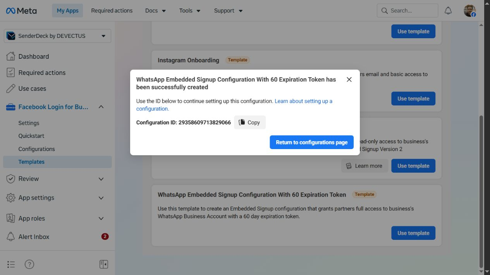
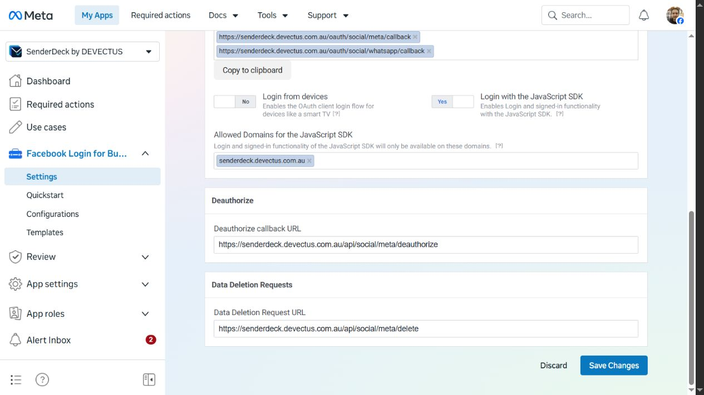
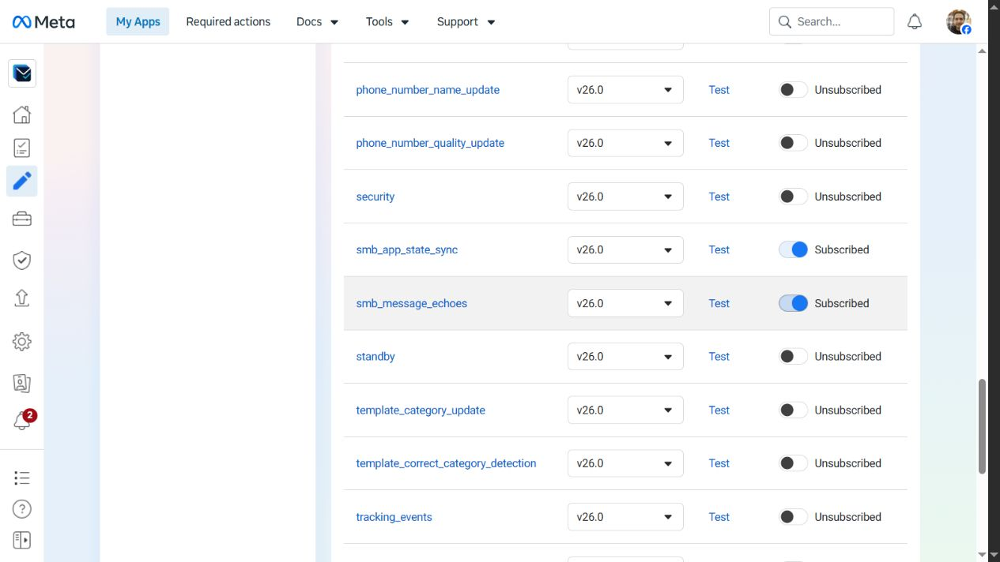

# Approved Meta configuration receipt — 26 October 2026

The owner explicitly approved the three Meta configuration actions after reviewing their exact scope in chat. This receipt supersedes the pending status of those actions in [the earlier preparation pack](WHATSAPP-APP-REVIEW-2026-10-26.md). The earlier pack remains the record of the initial investigation and unsubmitted review materials.

## Completed and verified

| Action | Saved result and verification |
| --- | --- |
| Separate Embedded Signup configuration | Created from **WhatsApp Embedded Signup Configuration With 60 Expiration Token** in Meta app `2213673322866707`. New configuration ID **`29358609713829066`**; confirmed by creation-success dialog and subsequent Configurations list. Existing configurations preserved. |
| Login variation and permissions | Template confirmation showed **WhatsApp Embedded Signup**, WhatsApp accounts, system-user token configuration with 60-day expiry, and exactly **whatsapp_business_management** + **whatsapp_business_messaging**. No OAuth user grant or actual token was generated. The template's default display name was retained. |
| SDK login | **Login with the JavaScript SDK = Yes**. Only `senderdeck.devectus.com.au` was added; Meta's saved readback normalizes it to `https://senderdeck.devectus.com.au/`. Verified after navigating away and reopening Settings. |
| App webhook | On existing callback `https://senderdeck.devectus.com.au/api/social/webhooks/meta`, added **account_update**, **history**, **smb_app_state_sync**, **smb_message_echoes**, all v26.0. Existing **messages** remains subscribed. All five read back **Subscribed** after a full reload. Callback and verification token were preserved. |

HTTPS and Strict Mode remain enabled; existing OAuth redirect URIs, deauthorisation and data-deletion URLs remain unchanged. Embedded browser OAuth login remains disabled; its broader surface was not part of the approved changes.

## Synthetic callback tests

Meta's dashboard reported **Successfully tested** for each of the four new v26.0 fields: `smb_message_echoes`, `history`, `smb_app_state_sync`, `account_update`.

These used Meta's built-in sample data with example numbers and phone IDs, sent to the existing SenderDeck callback. They were not outbound WhatsApp messages, did not connect the real number, did not import real conversations or address books, and do not establish mapped-account processing, real phone-app behavior, the required App Review API counters, or customer delivery. The sample `account_update` event was `VERIFIED_ACCOUNT`, not an offboarding request.

The live configuration page explicitly warns that unpublished apps receive only dashboard test webhooks, and **no production webhook data, even from app-role users, until publication**. Keep this separate from Standard-access permission/API testing guidance. App publication was not approved or performed in this pass.

## Remaining work

**Hosting activation update:** the owner subsequently requested proceeding step by step. `WHATSAPP_COEXISTENCE_CONFIG_ID=29358609713829066` was saved in Sites environment revision **26**, then the existing saved version **70** (SenderDeck 0.4.31, source `d9cc13170a5a64cf6323049ed81dc2443cc93a1e`) was successfully redeployed. Deployment: `appgdep_6adf42ab6c488191b067c7ba761d6a86`. No source/package change was deployed. The live wizard's configuration-pending notice cleared. Live SenderDeck status confirmed `whatsapp.coexistence.configured=true`, `sending=disabled`, access tier `development`, and DEVECTUS `sendEnabled=false`. The consent checkbox remains unchecked; Meta SDK login, OAuth, number connection and synchronization were not started. This completes item 1 below; the other items remain outstanding. Production URL: https://senderdeck.devectus.com.au.

1. **Completed in the hosting activation update above:** `WHATSAPP_COEXISTENCE_CONFIG_ID=29358609713829066` was saved and deployed with version 70. The configuration-pending notice cleared; this is configuration readiness, not provider approval or completed onboarding.
2. Recheck Tech Provider review status before real onboarding; the last verified state was **In review**. Configuration creation is not Tech Provider approval or number eligibility.
3. Complete the two genuine, separate permission recordings and required live API calls using authorised test assets; verify Meta's counters. Obtain an exact test-send approval after draft inspection. No such send was made here.
4. Finalise dedicated reviewer access and owner-verified data handling/allowed-use declarations. The existing broad review draft has unrelated Facebook/Instagram/ads requests; do not submit or remove those without approval.
5. Review final materials and obtain submission/publication authorisation. No App Review submission, legal declaration or app publication was performed here.
6. After readiness and owner consent, complete Coexistence for **+61 485 040 099** and verify the exact finish event, simultaneous Business app/API state and real signed delivery. SDK launch, configuration product/version compatibility and phone eligibility remain untested. If Meta requires further domain/redirect settings, embedded-browser login or terms, review those exact requirements before changing them.

## Number and service preservation

**Review demonstration preparation:** the owner approved **+61 493 091 392** as the test recipient, not an actual message send. Meta API Setup listed only the existing live sender **+61 3 6469 3417**. Its **Get new test number** action returned **“WhatsApp numbers are currently unavailable. Try again later.”** No new test number or token was returned. WhatsApp Manager's account picker listed the existing business accounts, not an alternative dedicated test sender. Do not infer provider eligibility denial from this transient allocation error, and do not substitute the existing production sender or migrate the Business app number. No token generation, recipient verification message or WhatsApp message was initiated. The demonstration remains blocked on a usable authorised test sender; owner declarations can proceed independently.

No Twilio call routing, SMS webhook, Messaging Service, number ownership or registration was changed. No phone registration/deregistration/migration operation was performed. **+61 485 040 099 remains in the WhatsApp Business phone app.** This pass made no call/SMS end-to-end availability test; it preserves the existing configuration rather than claiming such a test.

## Independent Tech Provider onboarding started 27 October 2026

The owner explicitly approved accepting Meta's Tech Provider Terms and starting Independent Tech Provider onboarding for app `2213673322866707`. The final **Start onboarding** action was performed. Meta then displayed the independent-provider checklist with **1 of 2 steps complete**, business verification **Approved** and App Review outstanding. The checklist's generic **In review** badge was checked against the actual submissions screen, which explicitly showed **Not submitted**, including both WhatsApp permissions alongside existing unrelated requests. No App Review submission or permission removal was performed.

Separate portfolio access verification remains in review, submitted 22 October 2026. Required actions had no outstanding tasks. Meta's updated account structure separates phone-number WhatsApp accounts from messaging accounts for templates/billing. The Business App messaging account **DEVECTUS Support** (`1819700282322786`), owned by the Devectus portfolio, reports account status **Approved** and lists target `+61 485 040 099` with **Offline** status. Another phone-number summary with that number showed **Unverified** and a linked pending `+1 555…` entry; do not equate those separate records or infer that the phone app is unusable. No assignment, registration, migration, payment setting or existing Twilio configuration was changed.

SenderDeck is free and open source. Meta's technical integration role and permissions do not imply that SenderDeck is a paid service. Draft review descriptions must reflect that distinction accurately. Onboarding initiation is not approval or an active number connection.

After starting provider onboarding, a fresh **Get new test number** request succeeded. Meta API Setup verified **Test number: +1 555 168 1965**, phone-number ID `1433044106557621`. This supersedes the earlier transient allocation failure. No message, recipient verification or payment setting was initiated. An isolated **SenderDeck WhatsApp Review** brand (`4cb583d1-9024-4f0f-b03f-7cd84ac06afb`) was created under the existing DEVECTUS workspace with sending disabled. Its intended connection is only this Meta test sender, using the existing Cloud API path; the real Business app number continues to require Coexistence and must not be migrated.

## Test account connection completed 27 October 2026

The owner separately approved saving access only to **Test Messaging Account** `957296627055310`, containing test number **+1 555 168 1965**, for the two WhatsApp management/messaging permissions. The consent selection excluded other accounts and future accounts. Meta confirmed the connection. SenderDeck's initial ten-minute OAuth state had expired while approval was pending; a new session reused the just-approved settings and completed successfully.

The exact test phone ID `1433044106557621` was discovered through the authorised account and selected for **SenderDeck WhatsApp Review**. Saved SenderDeck account ID: `7d917aa0-20de-438f-b8be-ae984ddcb733`. Both the live UI and account-list API report **connected**. The returned token metadata also lists previously granted Facebook/Instagram/advertising scopes; the two-permission consent screen must not be described as proof that the token contains only WhatsApp scopes. No unrelated permissions were requested or removed in this flow.

Connection is not delivery readiness: account webhook subscription is **unverified**, no signed delivery has been observed, monitoring is off and sending remains disabled. Next preparation requires the exact test messaging account's app subscription and an individually approved test send. No recipient verification, outbound message, app publication or App Review submission occurred. The real Business app number and Twilio configuration were unchanged. UI proof: `work/whatsapp-test-number-connected.png`.

## Test account webhook subscription verified 27 October 2026

The owner requested completion of the exact test account's subscription. The existing server action `social_webhook_subscribe` already supports WhatsApp, but operator diagnostics filtered out WhatsApp accounts and exposed a repair button only for Facebook. The earlier statement that no account-subscribe action existed was incomplete: the gap was the operator UI.

Released **0.4.32** from the clean deployed 0.4.31 source, adding WhatsApp to operator diagnostics, the existing subscription repair control and explicit messaging-account context. The unfinished Connections redesign and governance edits were excluded. Type checking, production build and all **22 rendered-page checks** passed. Saved version **71**, source `ef26fef84b78a96f89c02a3f729e2fe8ae0ca48e`, deployment `appgdep_6ae040e8e9d48191b23e285787f2a379`, environment revision **26**, succeeded. Rollback: redeploy saved version 70; this UI rollback does not remove the independently installed Meta account subscription.

In the authenticated operator UI, selected **SenderDeck WhatsApp Review** and its sole test phone `1433044106557621` / messaging account `957296627055310`, then ran **Repair WhatsApp event subscription**. The server verified current grant membership before POSTing the subscription. Independent `social_account_validate` readback returned `validation.webhook=true`, `errors=[]`, and `capabilities.webhook=true`. The UI also reports `subscriptionVerified=true`. Proof: `work/whatsapp-test-webhook-verified.png`.

Signed delivery is not yet observed; global/brand sending remains disabled. Meta API Setup's test-recipient list was empty. Opened **Add a recipient phone number**, selected Australia and prepared the owner's previously selected personal test number `+61 493 091 392`. Stopped before **Next** and handed the verification step to the owner; no verification code was requested. Proof: `work/whatsapp-test-recipient-prepared.png`.

No message, completed recipient verification, phone registration, initial synchronization, App Review submission or publication of the Meta app occurred. Twilio and the real Business app number were unchanged. After recipient verification, a fresh owner-originated message to the test number is the next delivery experiment, not proof that Meta will deliver it while its other gates remain pending.

## Meta test message accepted 28 October 2026

After the earlier setup error, the owner explicitly approved generating a temporary token limited to the test account and retrying the same `hello_world` template once from `+1 555 168 1965` to `+61 493 091 392`. Meta's dashboard generated the token in place; no broader-permission prompt appeared. The token was not copied to chat or files. Its exact effective scopes were not independently inspected, so do not infer a narrowly scoped token solely from the selected test phone. This did not revoke the token previously exposed in the owner's screenshot.

The one approved dashboard retry returned **Test message successfully sent to 61493091392**. This is Meta's acceptance result, not confirmed delivery to the phone. Credential-free receipt: `work/whatsapp-meta-test-send-success.png`. SenderDeck's retained-webhook inbox was still empty immediately afterward. Owner should reply in the received test chat with **SenderDeck approval workflow test.**; actual signed inbound delivery and the approval workflow remain to be verified. SenderDeck's global/brand sending controls were unchanged. No second send was attempted.

## Evidence

Configuration and permissions were inspected in the authenticated Meta UI. Browser readback, not screenshots alone, verified SDK persistence, callback and all five field subscriptions.
